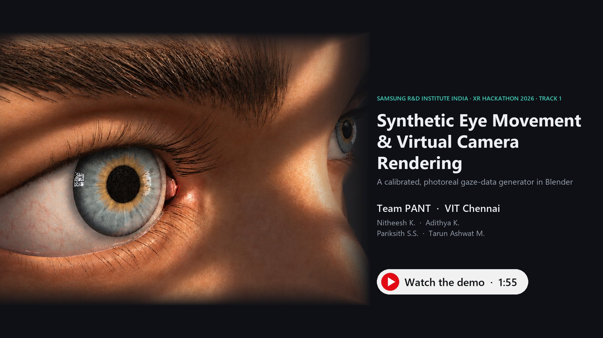
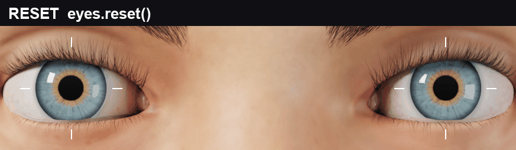
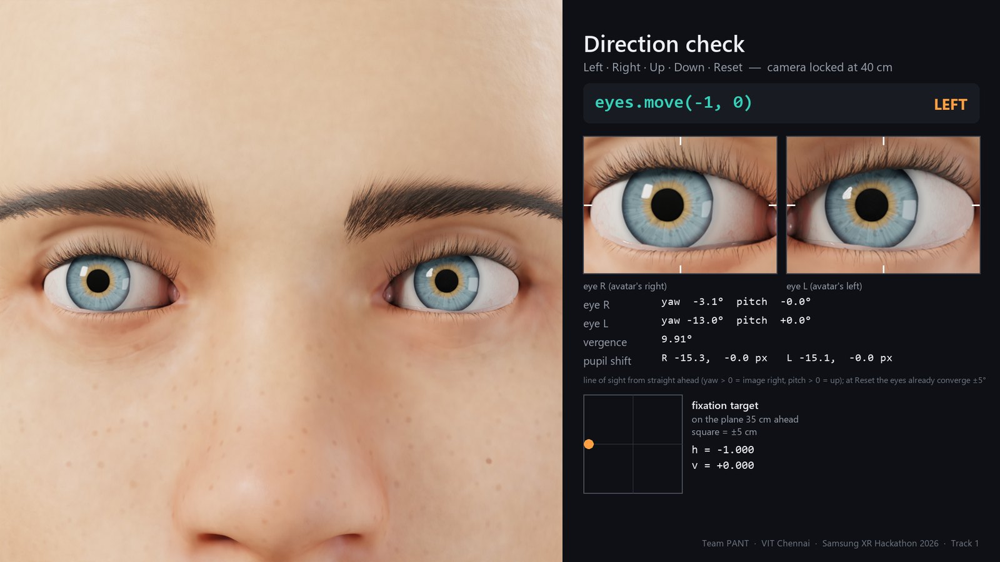
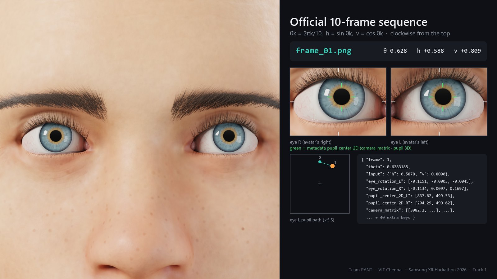
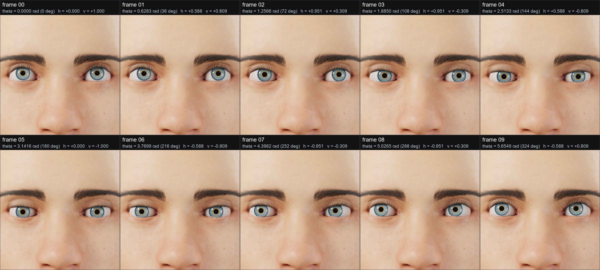
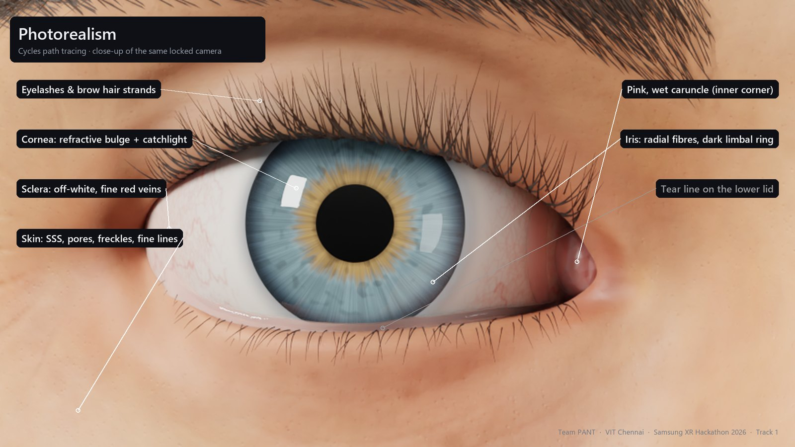
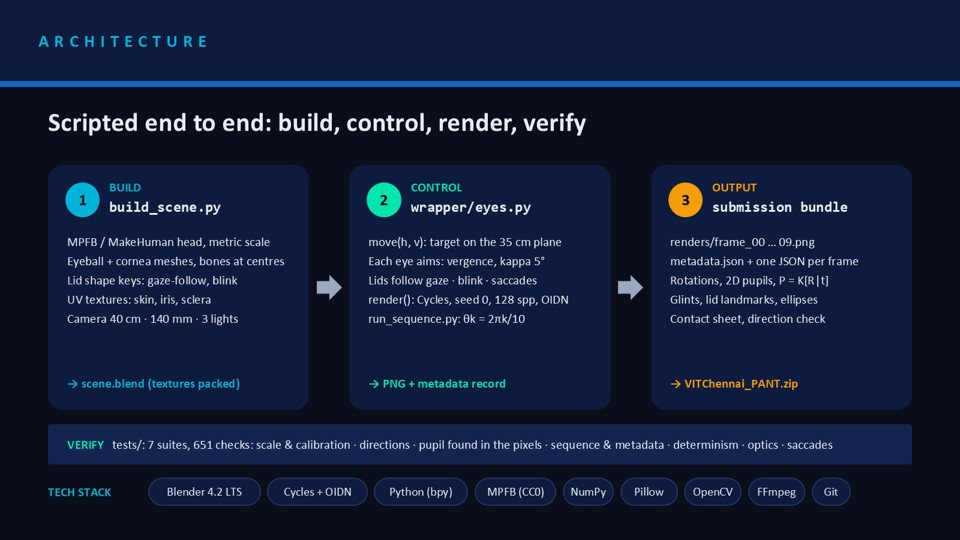

<div align="center">

Notice : VITChennai_PANT.zip is the zip file you're most probably looking for. Everything in that zip file is unzipped in the folder Submission_Package. Thank you for reviewing our work!

# Synthetic Eye Movement & Virtual Camera Rendering

**Samsung R&D Institute India · XR Hackathon 2026 · Track 1**<br>
**Team PANT · VIT Chennai**

A calibrated, photoreal gaze-data generator in Blender: a human face whose eyeballs rotate as
true 3D spheres, driven by three lines of Python, with exact ground truth for every image.

[](https://www.blender.org/)
[](Source_Code)
[](Source_Code/tests)
[](#the-problem)

[](https://www.youtube.com/watch?v=YICEQyBMeDM)

**[▶ Watch on YouTube](https://www.youtube.com/watch?v=YICEQyBMeDM)** ·
**[🎞 Video in this repo](Video/VITChennai_PANT_Track1_Demo.mp4)** ·
**[📊 Presentation (PPTX)](Presentation/VITChennai_PANT.pptx)** ·
**[📄 Presentation (PDF)](Presentation/VITChennai_PANT.pdf)** ·
**[📦 Submission package](Submission_Package)**

</div>

---

## The team

| Name | Register No. | Email | Affiliation |
| --- | --- | --- | --- |
| Nitheesh K. | 24BEC1459 | nitheesh.k2024@vitstudent.ac.in | VIT Chennai |
| Adithya K. | 24BEC1304 | adithya.k2024@vitstudent.ac.in | VIT Chennai |
| Pariksith S.S. | 24BEC1454 | pariksith.ss2024@vitstudent.ac.in | VIT Chennai |
| Tarun Ashwat M. | 24BEC1435 | tarun.ashwat2024@vitstudent.ac.in | VIT Chennai |

*PANT* = **P**ariksith · **A**dithya · **N**itheesh · **T**arun

## The problem

To track your eyes, an XR headset learns from huge numbers of eye images, each labelled with
exactly where the eye is looking. Capturing real ones is slow, expensive and limited by
privacy, and hand-made labels are only approximate. **So we render them instead**, with labels
that are exact by construction.

## What we built

- **Real 3D eyes.** Each eyeball is a separate sphere on its own eye bone and rotates about its
  anatomical centre; the pupil, iris and a refracting cornea move with it as one rigid body.
- **Calibrated to the real world.** Metric scale (61.9 mm between the pupils, 25 mm eyeballs),
  a fixation target 35 cm ahead moving ±5 cm, and a camera locked 40 cm in front of the eyes.
  Each eye aims at the target on its own, so the two eyes converge (vergence).
- **Three lines of Python.** `eyes.move(h, v)`, `eyes.reset()`, `eyes.render()`: headless,
  deterministic, GPU or CPU.
- **Exact labels.** Every 1024 × 1024 render ships with eye rotations, projected 2D pupil
  centres and the camera matrix `P = K[R|t]`, plus 40 extra labels.

<div align="center">



</div>

  ## Results

Measured by the automated test suite on the final scene, not assumed.

| Metric | Result |
| --- | --- |
| Pupil shift, Left / Right / Up / Down | **15.1 – 15.4 px**, right direction, both eyes |
| Reset returns to the start | exact |
| Label vs pupil detected in the rendered PNG | **≤ 1.36 px** (refracted label ≤ 0.22 px) |
| Lines of sight through the target | miss < 0.001 mm, vergence 10.0° at Reset |
| Camera / target distances | 0.40000 m / 0.35000 m |
| Same input twice | identical image |
| Clean run from the zip | regenerates all renders; metadata matches to 1e-9 |
| Automated checks | **651 / 651 pass** (7 suites) |

## Quick start

Needs only **Blender 4.2 LTS**. Run from [`Submission_Package/`](Submission_Package):

```bash
# all 10 renders + metadata.json (about 25 s per frame on a laptop RTX 3050)
blender --background scene.blend --python wrapper/run_sequence.py

# one direction: left, right, up, down or reset
blender --background scene.blend --python wrapper/eyes.py -- --look left --out output/left.png

# the full verification suite
python tests/run_all.py

# play with the eyes: a "Gaze" tab with sliders in Blender's sidebar
blender scene.blend --python tools/gaze_panel.py
```

Or from Python inside Blender:

```python
import eyes
eyes.move(-1, 0)           # look left
path, record = eyes.render()
eyes.reset()
```

Conventions: `+h` moves the pupils toward the image right and `+v` up; rotations are XYZ
Euler angles in radians in the world frame; pixels start at the top-left corner, x right,
y down. The full technical documentation is in
[`Submission_Package/README.md`](Submission_Package/README.md).

## Repository layout

```
VITChennai_PANT/
├── Submission_Package/     the Track 1 bundle, exactly as the evaluator expects
│   ├── scene.blend         textured face, eye bones, materials (textures packed)
│   ├── wrapper/eyes.py     eyes.move(h, v) / eyes.reset() / eyes.render()
│   ├── renders/            frame_00.png … frame_09.png
│   ├── metadata.json       10 per-frame records
│   ├── README.md           setup, conventions, calibration, metadata reference
│   └── textures/ tests/ metadata_frames/ direction_check/ contact_sheet.png
├── Source_Code/            all the code: wrapper, scene build, tests, tools
├── Presentation/           VITChennai_PANT.pptx and .pdf
├── Video/                  the demo video (also on YouTube)
├── AI_Disclosure.md
└── README.md
```


## See it in action

### Direction check: Left · Right · Up · Down · Reset

One command per direction; the camera never moves. Both pupils shift about **15 px** in
the commanded direction. The live readouts come straight from the scene.



<div align="center">


</div>

### True 3D rotation, not a sliding texture

Same motion with the face hidden: rigid eyeballs turning about their centres, each eye's line
of sight meeting at the shared target 35 cm away.

### The official 10-frame sequence

θk = 2πk/10, h = sin θk, v = cos θk: clockwise, starting with the eyes looking up. Green
marks are the metadata's `pupil_center_2D`, drawn on the real render.





<details>
<summary><b>A metadata record (frame 3, abridged)</b></summary>

```json
{
  "frame": 3,
  "theta": 1.8849556,
  "input": { "h": 0.9510565, "v": -0.3090170 },
  "eye_rotation_L": [0.0441, -0.0010, 0.0473],
  "eye_rotation_R": [0.0430, -0.0048, 0.2205],
  "pupil_center_2D_L": [843.21, 516.77],
  "pupil_center_2D_R": [209.78, 516.72],
  "camera_matrix": [[3982.2, 512.0, ...], ...],
  "...": "quaternions, gaze vectors, vergence, corneal glints, eyelid landmarks, iris and pupil ellipses"
}
```

Full records: [`Submission_Package/metadata.json`](Submission_Package/metadata.json).
</details>

### Photorealism

Path-traced in Cycles: a refracting cornea with catchlights, iris fibres and a limbal ring,
veined sclera, a wet pink caruncle, a tear line, and skin with subsurface scattering, pores
and freckles. Saccades follow human timing, the eyes blink, and the lids follow the gaze.




## Architecture



**Tech stack:** Blender 4.2 LTS (Cycles, OpenImageDenoise) · Python (`bpy`, `mathutils`) ·
MPFB / MakeHuman (CC0) · NumPy · Pillow · OpenCV · FFmpeg · Git

## AI disclosure

The 3D modelling and art direction were done by humans: the face is the open MakeHuman / MPFB
model, and every look decision was made and approved by the team. The Python code was written
with the help of AI coding assistants (Claude and ChatGPT). Details:
[`AI_Disclosure.md`](AI_Disclosure.md).

## Assets and licences

| Asset | Source | Licence |
| --- | --- | --- |
| Base mesh, rig, skin texture, eyebrows, eyelashes | MakeHuman community assets, via MPFB | CC0 1.0 |
| Clothing (viewport only, not rendered) | MakeHuman community assets, via MPFB | CC0 1.0 |
| MPFB add-on (build-time tool only, not distributed) | extensions.blender.org | GPL-3.0-or-later |
| Eyeball geometry, eye textures, baked skin maps, all scripts | this project | made for this submission |

## Acknowledgements

Thanks to the XR team at SRI-B whose guidance shaped the project! #NewValley2026
